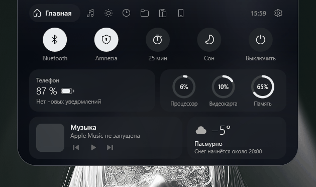
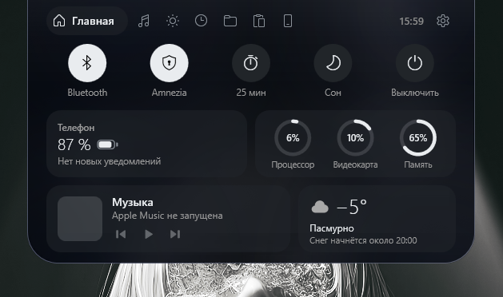
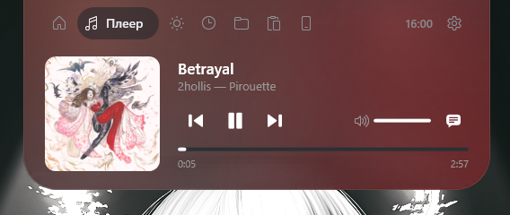
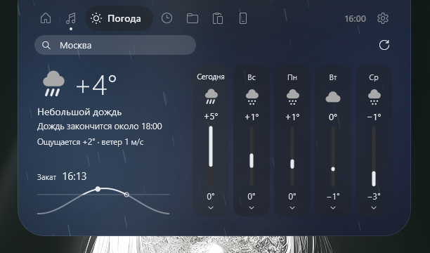
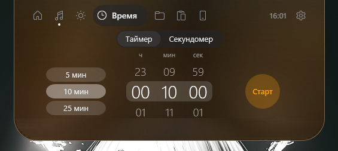
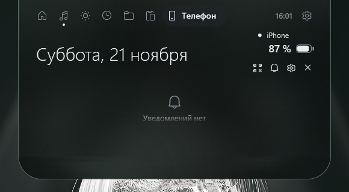
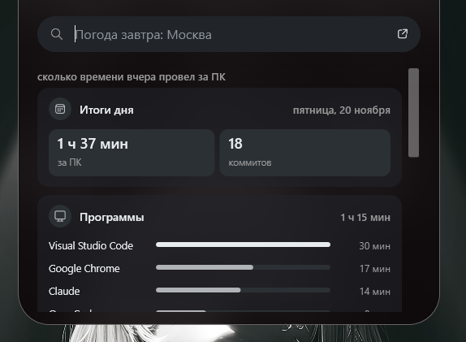

<div align="center">

# Ostrov — a Dynamic-Island-style launcher for Windows 11

A small black pill at the top of your screen. Click it and it opens up with music, weather, timers, projects, clipboard, phone notifications and more. While collapsed it quietly shows what is going on: a timer running, music playing, Claude working.

**[На русском](README.md)** · [Design playground](docs/island-demo.html) · [Architecture](docs/ARCHITECTURE.md) · [Contributing](CONTRIBUTING.md)



</div>

> **Status: personal project, rough edges included.** Built by one person (with a lot of help from an AI coding assistant, Claude Code, which wrote most of the code under the author's direction and review) and tested on a single machine: Windows 11, one monitor, Apple Music, VS Code, an iPhone. Things may break elsewhere. Bug reports and ideas are very welcome.
>
## How it looks

<table>
<tr>
<td></td>
<td></td>
</tr>
<tr>
<td></td>
<td></td>
</tr>
<tr>
<td></td>
<td></td>
</tr>
</table>

## What it does

The island lives at the top edge of the screen. Collapsed, it is tiny and shows only what matters (a timer, music, a download, "Claude is working"). Click it to open it up with tabs.

| Tab | What is inside |
| --- | --- |
| **Home** | Everything you need on one screen: Bluetooth, VPN, timer, sleep and power; phone battery and the last notification; CPU, GPU and RAM load; music and weather |
| **Player** | Cover, buttons, volume and lyrics that follow the song (word by word when available). For **Apple Music**. The background takes the colours of the cover |
| **Weather** | A forecast for several days and by the hour, a short line like "rain until 8 pm", quiet rain or snow in the background |
| **Time** | An iPhone-style timer with wheels and a stopwatch with laps. A running timer also shows on the collapsed island |
| **Projects** | Open a folder in VS Code with one click. You can pin and search |
| **Buffer** | What you copied (text and images) and a "shelf": drop a file on the island to keep it at hand |
| **Phone** | Battery and notifications of your **iPhone**. Plus a QR code: scan it to send files and text between phone and PC over your home network |
| **Settings** | Transparency and blur, night mode, hotkeys, dictation, the list of apps next to which the island shrinks, an optional SSH tunnel |

And these work even when no tab is open:

- **Claude Code.** When Claude asks for permission or asks a question, a card with "Allow" and "Deny" buttons appears on the island. While it works you can see what it is doing, and the island tells you when it is done.
- **Quick question (Alt+Q).** A line where you can type anything: a sum (`15% of 200`), a command (`timer 25`, `volume 30`, `open project`), "100 dollars in rubles", "day summary" or a regular question. Questions are answered by AI (OpenAI, you need your own key), right on the island.
- **Dictation.** Hold the right Alt key and speak (Russian or English), release, and the text is typed where your cursor is.
- **After Effects render.** The island shows that a render is running and when it finishes (a small script inside After Effects does this).
- **Notch mode.** When a browser or fullscreen video is open, the island shrinks to a thin pill so it does not get in the way. In games it hides completely.
- **Short hints.** Caps Lock, input language, volume and microphone; browser download progress; low disk space; reminders ("remind me in an hour to rest").

## Requirements

- Windows 11 (Windows 10 may partly work; untested)
- To run a release build: the **.NET 10 Desktop Runtime**
- To build: **.NET 10 SDK**

## Build and run

```powershell
git clone https://github.com/ment4l-immo/ostrov.git
cd ostrov
dotnet run --project src/Ostrov
```

or publish a local copy and start it (closes a running instance first):

```powershell
.\Ostrov-update.bat      # publishes to dist\ and launches dist\Ostrov.exe
```

Logic tests: `dotnet test tests/Ostrov.Tests`.

Release builds are **not code-signed**, so Windows SmartScreen will warn on first launch. The phone bridge asks Windows for firewall access the first time you open it.

## Optional setup

**OpenAI features** (Alt+Q answers, dictation, news summaries): paste your own API key in *Settings → AI & search*. It is stored encrypted with Windows DPAPI under `%AppData%\Ostrov` and never leaves your machine except in requests to OpenAI. You can also set the `OPENAI_API_KEY` environment variable.

**Claude Code hooks** (permission cards, "working / finished" status): add the hook to your Claude Code `settings.json` (global or per project), with the real path to this repository:

```json
{
  "hooks": {
    "PermissionRequest": [{ "hooks": [{ "type": "command", "timeout": 3600,
      "command": "powershell -NoProfile -ExecutionPolicy Bypass -File \"C:\\path\\to\\ostrov\\tools\\ostrov-hook.ps1\"" }] }],
    "UserPromptSubmit": [{ "hooks": [{ "type": "command", "timeout": 10,
      "command": "powershell -NoProfile -ExecutionPolicy Bypass -File \"C:\\path\\to\\ostrov\\tools\\ostrov-hook.ps1\"" }] }],
    "Stop": [{ "hooks": [{ "type": "command", "timeout": 10,
      "command": "powershell -NoProfile -ExecutionPolicy Bypass -File \"C:\\path\\to\\ostrov\\tools\\ostrov-hook.ps1\"" }] }],
    "PreToolUse": [{ "matcher": "*", "hooks": [{ "type": "command", "timeout": 10,
      "command": "powershell -NoProfile -ExecutionPolicy Bypass -File \"C:\\path\\to\\ostrov\\tools\\ostrov-hook.ps1\"" }] }],
    "PostToolUse": [{ "matcher": "*", "hooks": [{ "type": "command", "timeout": 10,
      "command": "powershell -NoProfile -ExecutionPolicy Bypass -File \"C:\\path\\to\\ostrov\\tools\\ostrov-hook.ps1\"" }] }]
  }
}
```

The hook talks to the island over a local named pipe only (no network). If the island is not running the hook exits instantly and Claude Code behaves as usual. The island reads only tool names, short file names, project names and session ids — never prompts, answers or command contents.

**After Effects**: copy `tools/ae/ostrov-render-notify.jsx` into `Support Files\Scripts\Startup` of your After Effects folder (needs admin rights once) and enable *Allow Scripts to Write Files and Access Network*.

**Phone tab**: pair your iPhone with Windows *Phone Link* (Bluetooth). Notifications from apps you turn off in Windows are invisible to Ostrov.

## Privacy and network

Nothing is collected and there is no telemetry. The app talks to the network only for the features you use:

| Feature | Service | What is sent |
| --- | --- | --- |
| Weather | Open-Meteo | City coordinates |
| Lyrics | LRCLIB | Track title, artist, album, duration |
| Track info, phone app icons | Apple iTunes Search API | Title / artist / album, or app name |
| Currency | open.er-api.com | Currency code |
| AI answers, dictation, summaries | OpenAI API | Your question or audio, with your own key, only when you use it |
| Optional tunnel | Your own server over SSH | Only OpenAI requests |

Local data (clipboard history, settings, day journal, reminders…) lives in `%AppData%\Ostrov`. The day journal stores only program names and durations, never window titles, and can be switched off and cleared in Settings.

## Known limitations

- Apple Music sound for the wave is taken from its helper process; a different music app will show cover and controls but not the wave.
- The glass uses the Windows acrylic backdrop in a separate window under the island, so the blur strength is set by Windows; Liquid-Glass-style refraction at the edges is not possible this way.
- Phone notifications and battery need the phone connected over Bluetooth through Phone Link.
- No tests for the UI; only the pure logic (calculator, parsers, QR encoder, ranking) is covered.
- Code comments are mostly in Russian.

## Trademarks

Ostrov is an independent hobby project. It is **not affiliated with or endorsed by** Anthropic, Apple, OpenAI, Microsoft, Adobe or any other company mentioned. Claude, Apple Music, iPhone, OpenAI, After Effects, VS Code and other names are trademarks of their owners and are used only to describe what the app integrates with. The project contains no third-party logos or assets; every icon is drawn in code or comes from fonts that ship with Windows.

## License

[MIT](LICENSE)
