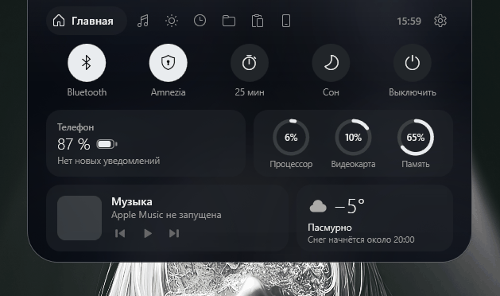
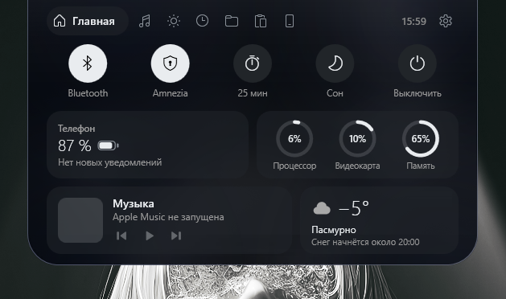
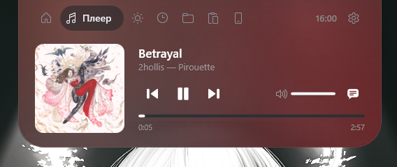
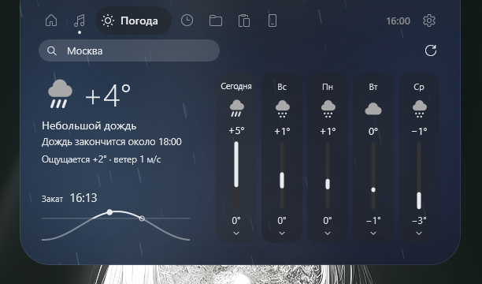
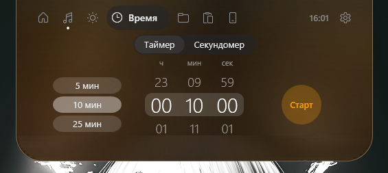
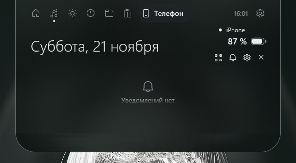
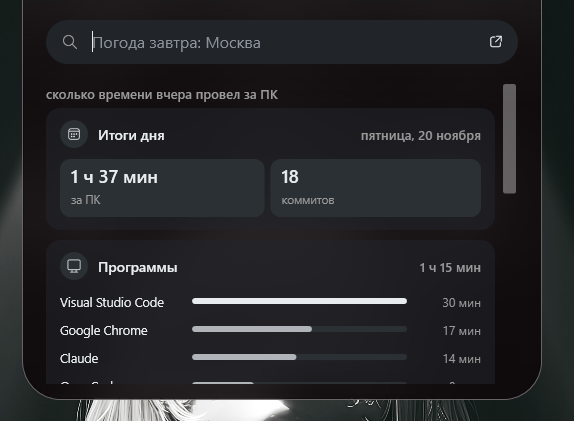

<div align="center">

# Остров — динамический остров для Windows 11

Маленькая чёрная плашка вверху экрана. Нажмёшь — она раскрывается и показывает музыку, погоду, таймеры, проекты, буфер обмена, уведомления с телефона и многое другое. А пока свёрнута, тихо подсказывает, что происходит: идёт таймер, играет музыка, Claude работает.

**[English](README.en.md)** · [Стенд дизайна](docs/island-demo.html) · [Устройство](docs/ARCHITECTURE.md) · [Как участвовать](CONTRIBUTING.md)



</div>

> **Статус: личный проект, с шероховатостями.** Его делает один человек, а большую часть кода по его заданиям и под его проверкой написал ИИ-ассистент Claude Code. Проверялся на одном компьютере: Windows 11, один монитор, Apple Music, VS Code, iPhone. На других системах что-то может не работать. Сообщения об ошибках и идеи очень приветствуются.

## Как это выглядит

<table>
<tr>
<td></td>
<td></td>
</tr>
<tr>
<td></td>
<td></td>
</tr>
<tr>
<td></td>
<td></td>
</tr>
</table>

## Что умеет

Остров живёт у верхнего края экрана. Свёрнутый, он совсем маленький и показывает только самое важное (таймер, музыку, загрузку, «Claude работает»). Нажмите на него, и он раскроется со вкладками.

| Вкладка | Что внутри |
| --- | --- |
| **Главная** | Всё нужное на одном экране: Bluetooth, VPN, таймер, сон и выключение; заряд телефона и последнее уведомление; загрузка процессора, видеокарты и памяти; музыка и погода |
| **Плеер** | Обложка, кнопки, громкость и текст песни, который идёт в такт (по словам, если такой есть). Для **Apple Music**. Фон окрашивается в цвета обложки |
| **Погода** | Прогноз на несколько дней и по часам, короткая фраза вроде «дождь закончится около 20:00», на фоне тихо идут дождь или снег |
| **Время** | Таймер с колёсами как в iPhone и секундомер с кругами. Идущий таймер виден и на свёрнутом острове |
| **Проекты** | Открывают папку в VS Code одним щелчком. Можно закреплять и искать |
| **Буфер** | История того, что вы копировали (текст и картинки), и «полка»: бросьте на остров файл, чтобы он был под рукой |
| **Телефон** | Заряд и уведомления **iPhone**. Ещё QR-код: отсканируйте его, и файлы и текст можно передавать между телефоном и компьютером по домашней сети |
| **Настройки** | Прозрачность и размытие, ночной режим, горячие клавиши, диктовка, список программ, рядом с которыми остров сжимается, SSH-тоннель (по желанию) |

А это работает, даже когда ни одна вкладка не открыта:

- **Claude Code.** Когда Claude просит разрешение или задаёт вопрос, на острове появляется карточка с кнопками «Разрешить» и «Запретить». Пока он работает, видно, что именно он делает, а когда закончит, остров скажет об этом.
- **Быстрый вопрос (Alt+Q).** Строка, в которую можно написать что угодно: пример (`15% от 200`), команду (`таймер 25`, `громкость 30`, `открой проект`), «100 долларов в рубли», «итоги дня» или обычный вопрос. На вопросы отвечает ИИ (OpenAI, нужен свой ключ), ответ появляется прямо на острове.
- **Диктовка.** Зажмите правый Alt и говорите (по-русски или по-английски), отпустите, и текст напечатается там, где стоит курсор.
- **Рендер After Effects.** Остров показывает, что рендер идёт и когда он закончился (для этого в After Effects стоит маленький скрипт).
- **Режим «нотч».** Когда открыт браузер или видео на весь экран, остров сжимается в тонкую плашку, чтобы не мешать. В играх он прячется совсем.
- **Короткие подсказки.** Caps Lock, язык ввода, громкость и микрофон; ход загрузок в браузере; мало места на диске; напоминания («напомни через час отдохнуть»).

## Что нужно

- Windows 11 (на Windows 10 может частично работать, не проверялось)
- Чтобы запустить готовую сборку: **.NET 10 Desktop Runtime**
- Чтобы собрать самому: **.NET 10 SDK**

## Сборка и запуск

```powershell
git clone https://github.com/ment4l-immo/ostrov.git
cd ostrov
dotnet run --project src/Ostrov
```

Или собрать готовый exe и запустить (если остров уже запущен, он сначала закроется):

```powershell
.\Ostrov-update.bat      # собирает в dist\ и запускает dist\Ostrov.exe
```

Тесты логики: `dotnet test tests/Ostrov.Tests`.

Сборки **не подписаны**, поэтому при первом запуске Windows SmartScreen покажет предупреждение. А когда вы впервые откроете мост с телефоном, Windows спросит разрешение на доступ через брандмауэр.

## Настройка по желанию

**Функции с OpenAI** (ответы по Alt+Q, диктовка, краткие пересказы): вставьте свой ключ в *Настройки → ИИ и поиск*. Он хранится в зашифрованном виде (средствами Windows, DPAPI) в `%AppData%\Ostrov` и уходит только в запросах к OpenAI. Можно вместо этого задать переменную окружения `OPENAI_API_KEY`.

**Claude Code** (карточки разрешений и статус «работает / закончил»): добавьте хук в `settings.json` Claude Code (общий или проекта), указав настоящий путь к папке с проектом:

```json
{
  "hooks": {
    "PermissionRequest": [{ "hooks": [{ "type": "command", "timeout": 3600,
      "command": "powershell -NoProfile -ExecutionPolicy Bypass -File \"C:\\путь\\к\\ostrov\\tools\\ostrov-hook.ps1\"" }] }],
    "UserPromptSubmit": [{ "hooks": [{ "type": "command", "timeout": 10,
      "command": "powershell -NoProfile -ExecutionPolicy Bypass -File \"C:\\путь\\к\\ostrov\\tools\\ostrov-hook.ps1\"" }] }],
    "Stop": [{ "hooks": [{ "type": "command", "timeout": 10,
      "command": "powershell -NoProfile -ExecutionPolicy Bypass -File \"C:\\путь\\к\\ostrov\\tools\\ostrov-hook.ps1\"" }] }],
    "PreToolUse": [{ "matcher": "*", "hooks": [{ "type": "command", "timeout": 10,
      "command": "powershell -NoProfile -ExecutionPolicy Bypass -File \"C:\\путь\\к\\ostrov\\tools\\ostrov-hook.ps1\"" }] }],
    "PostToolUse": [{ "matcher": "*", "hooks": [{ "type": "command", "timeout": 10,
      "command": "powershell -NoProfile -ExecutionPolicy Bypass -File \"C:\\путь\\к\\ostrov\\tools\\ostrov-hook.ps1\"" }] }]
  }
}
```

Хук говорит с островом только через локальный канал на вашем компьютере, без сети. Если остров не запущен, хук тут же выходит, и Claude Code работает как обычно. Остров видит только названия инструментов, короткие имена файлов, названия проектов и номера сессий. Ваши запросы, ответы Claude и содержимое команд он не читает.

**After Effects:** скопируйте `tools/ae/ostrov-render-notify.jsx` в папку `Support Files\Scripts\Startup` внутри папки After Effects (один раз понадобятся права администратора) и включите «Allow Scripts to Write Files and Access Network».

**Вкладка «Телефон»:** свяжите iPhone с приложением Windows «Связь с телефоном» (по Bluetooth). Уведомления тех приложений, которые вы отключили в Windows, Остров не увидит.

## Приватность и сеть

Остров ничего не собирает и не отправляет статистику. В интернет он выходит только ради тех функций, которыми вы пользуетесь:

| Функция | Куда обращается | Что отправляется |
| --- | --- | --- |
| Погода | Open-Meteo | Координаты города |
| Тексты песен | LRCLIB | Название, исполнитель, альбом и длительность трека |
| Сведения о треке, значки приложений телефона | Apple iTunes Search API | Название, исполнитель и альбом или название приложения |
| Курсы валют | open.er-api.com | Код валюты |
| Ответы ИИ, диктовка, пересказы | OpenAI API | Ваш вопрос или голос, с вашим ключом и только когда вы этим пользуетесь |
| Тоннель (по желанию) | Ваш собственный сервер по SSH | Только запросы к OpenAI |

Всё остальное (история буфера, настройки, журнал дня, напоминания) лежит на вашем компьютере в `%AppData%\Ostrov`. В журнале дня только названия программ и время, без заголовков окон; его можно выключить и очистить в настройках.

## Что пока не так

- Звук для «волны» берётся из вспомогательного процесса Apple Music. Другой плеер покажет обложку и кнопки, но без волны.
- Стекло сделано из размытия Windows в отдельных окнах под островом, поэтому силу размытия задаёт сама Windows. Искажение краёв, как у Liquid Glass, таким способом сделать нельзя.
- Уведомления и заряд телефона работают, только пока телефон подключён по Bluetooth через «Связь с телефоном».
- Тестов интерфейса нет, проверена только логика (калькулятор, разборщики, QR-код, ранжирование).
- Комментарии в коде в основном на русском.

## Товарные знаки

Остров — независимый любительский проект. Он **не связан с компаниями** Anthropic, Apple, OpenAI, Microsoft, Adobe и другими упомянутыми и не одобрен ими. Claude, Apple Music, iPhone, OpenAI, After Effects, VS Code и другие названия — товарные знаки их владельцев, они здесь нужны только затем, чтобы сказать, с чем умеет работать приложение. Чужих логотипов и материалов в проекте нет: все значки нарисованы в коде или взяты из шрифтов, которые входят в Windows.

## Лицензия

[MIT](LICENSE)
