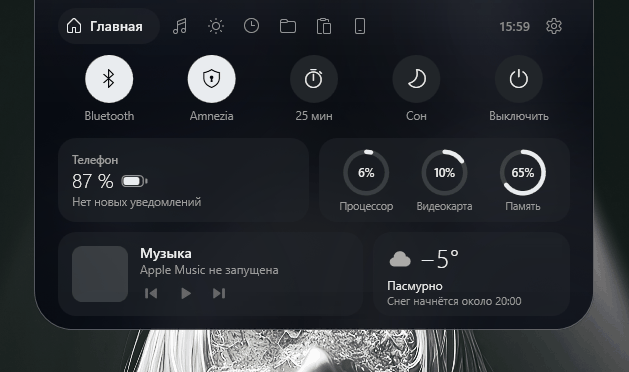

<div align="center">

# Остров — динамический остров для Windows 11

Маленькая чёрная плашка вверху экрана, которая раскрывается в музыку, погоду, таймеры, проекты, буфер обмена, уведомления с телефона, запросы Claude Code, быстрые ответы ИИ и многое другое.

**[English](README.md)** · [Стенд дизайна](docs/island-demo.html) · [Устройство](docs/ARCHITECTURE.md) · [Как участвовать](CONTRIBUTING.md)



</div>

> **Статус: личный проект, с шероховатостями.** Сделан одним человеком (с большой помощью ИИ-ассистента для кода, Claude Code: он написал большую часть кода по заданиям и под проверкой автора) и проверен на одном компьютере: Windows 11, один монитор, Apple Music, VS Code, iPhone. На других системах что-то может ломаться. Сообщения об ошибках и идеи очень приветствуются.
>
> Картинки выше — макет дизайна, нарисованный из HTML-стенда в `docs/` на выдуманных данных, а не снимки настоящих данных.

## Что умеет

Остров живёт у верхнего края экрана. Свёрнутый, это крошечная плашка, на которой видны пассивные активности (таймер, рендер, музыка, загрузки, «Claude работает»…). Клик раскрывает его в шапку со вкладками.

| Вкладка | Что внутри |
| --- | --- |
| **Главная** | Bluetooth, состояние VPN, таймер, сон, выключение; заряд телефона и последнее уведомление; кольца нагрузки процессора, видеокарты и памяти; мини-плеер; плитка погоды |
| **Плеер** | Обложка, управление и текст песни в такт (по словам, если есть) для **Apple Music** через системные медиа-функции Windows; цветной фон по обложке; волна по настоящему спектру звука |
| **Погода** | Прогноз Open-Meteo, график по часам, фраза-сводка («дождь до 20:00»), тихие дождь и снег на фоне |
| **Время** | Таймер с колёсами как в iPhone, секундомер с кругами; идущий таймер виден на свёрнутом острове |
| **Проекты** | Открыть папку в VS Code одним кликом, закрепление, поиск, точка «открыт сейчас» |
| **Буфер** | История буфера обмена (текст и картинки) и полка для файлов перетаскиванием |
| **Телефон** | Заряд и уведомления сопряжённого **iPhone** (через «Связь с телефоном» Windows), мост по QR-коду: передача файлов и текста между телефоном и ПК по домашней сети |
| **Настройки** | Стекло, размытие, ночной режим, горячие клавиши, диктовка, программы, при которых остров сжимается, необязательный SSH-тоннель |

И то, что работает без открытой вкладки:

- **Интеграция с Claude Code** — запросы разрешений и вопросы появляются карточками на острове («Разрешить / Запретить»); «Claude работает / закончил» с текущим шагом и списком сессий. Работает через *хуки* Claude Code.
- **Быстрые ответы (Alt+Q)** — калькулятор (`15% от 200`, `sqrt(2)*3`), команды (`таймер 25`, `громкость 30`, `открой проект`), пересчёт валют, итоги дня и ответы ИИ потоком прямо на острове (OpenAI API, ваш собственный ключ).
- **Диктовка «держи и говори»** — зажмите правый Alt, говорите (русский и английский), отпустите: текст напечатается в активное окно.
- **Уведомления о рендере After Effects** — маленький скрипт внутри AE сообщает ход и конец рендера.
- **Режим нотча** — в браузерах и полноэкранном видео остров сжимается в тонкий нотч с полоской, в полноэкранных играх прячется.
- **Короткие подсказки** — Caps Lock, язык ввода, громкость и микрофон; ход загрузок браузера; мало места на диске; напоминания и «сделай после рендера» обычными словами.

## Требования

- Windows 11 (на Windows 10 может частично работать; не проверялось)
- Чтобы запустить готовую сборку: **.NET 10 Desktop Runtime**
- Чтобы собрать: **.NET 10 SDK**

## Сборка и запуск

```powershell
git clone https://github.com/ment4l-immo/ostrov.git
cd ostrov
dotnet run --project src/Ostrov
```

или опубликовать локальную копию и запустить (запущенный остров сначала закрывается):

```powershell
.\Ostrov-update.bat      # публикует в dist\ и запускает dist\Ostrov.exe
```

Тесты чистой логики: `dotnet test tests/Ostrov.Tests`.

Сборки **не подписаны**, поэтому при первом запуске SmartScreen покажет предупреждение. Мост с телефоном при первом открытии попросит у Windows доступ через брандмауэр.

## Необязательная настройка

**Функции OpenAI** (ответы по Alt+Q, диктовка, краткие пересказы): вставьте свой ключ API в *Настройки → ИИ и поиск*. Он хранится зашифрованным средствами Windows (DPAPI) в `%AppData%\Ostrov` и уходит только в запросах к OpenAI. Можно задать и переменную окружения `OPENAI_API_KEY`.

**Хуки Claude Code** (карточки разрешений, статус «работает / закончил»): добавьте хук в `settings.json` Claude Code (глобальный или проекта), указав настоящий путь к репозиторию. Готовый пример в [английском README](README.md#optional-setup): пять записей (`PermissionRequest`, `UserPromptSubmit`, `Stop`, `PreToolUse`, `PostToolUse`) с командой `powershell -NoProfile -ExecutionPolicy Bypass -File "C:\путь\к\ostrov\tools\ostrov-hook.ps1"`.

Хук говорит с островом только по локальному именованному каналу (без сети). Если остров не запущен, хук мгновенно выходит и Claude Code работает как обычно. Остров читает только названия инструментов, короткие имена файлов, названия проектов и идентификаторы сессий — но не запросы, ответы и содержимое команд.

**After Effects**: скопируйте `tools/ae/ostrov-render-notify.jsx` в `Support Files\Scripts\Startup` папки After Effects (один раз нужны права администратора) и включите «Allow Scripts to Write Files and Access Network».

**Вкладка «Телефон»**: свяжите iPhone с «Связью с телефоном» Windows (Bluetooth). Уведомления приложений, выключенные в Windows, Остров не увидит.

## Приватность и сеть

Ничего не собирается, телеметрии нет. В сеть приложение ходит только ради тех функций, которыми вы пользуетесь:

| Функция | Сервис | Что уходит |
| --- | --- | --- |
| Погода | Open-Meteo | Координаты города |
| Тексты песен | LRCLIB | Название, исполнитель, альбом, длительность |
| Данные трека, значки приложений телефона | Apple iTunes Search API | Название, исполнитель, альбом или название приложения |
| Валюты | open.er-api.com | Код валюты |
| Ответы ИИ, диктовка, пересказы | OpenAI API | Ваш вопрос или звук, с вашим ключом и только когда вы пользуетесь |
| Необязательный тоннель | Ваш собственный сервер по SSH | Только запросы к OpenAI |

Локальные данные (история буфера, настройки, журнал дня, напоминания…) лежат в `%AppData%\Ostrov`. Журнал дня хранит только названия программ и время, без заголовков окон, его можно выключить и очистить в настройках.

## Известные ограничения

- Звук для волны берётся из вспомогательного процесса Apple Music; другой музыкальный плеер покажет обложку и кнопки, но не волну.
- Стекло — это акриловое размытие Windows в отдельном окне под островом, поэтому силу размытия задаёт Windows; искажение краёв как у Liquid Glass таким способом невозможно.
- Уведомления и заряд телефона работают, только пока телефон подключён по Bluetooth через «Связь с телефоном».
- Тестов интерфейса нет; покрыта только чистая логика (калькулятор, разборщики, QR-кодировщик, ранжирование).
- Комментарии в коде в основном на русском.

## Товарные знаки

Остров — независимый любительский проект. Он **не связан с компаниями** Anthropic, Apple, OpenAI, Microsoft, Adobe и другими упомянутыми и не одобрен ими. Claude, Apple Music, iPhone, OpenAI, After Effects, VS Code и другие названия — товарные знаки их владельцев, они используются только чтобы сказать, с чем приложение работает. В проекте нет чужих логотипов и материалов: все значки нарисованы в коде или взяты из шрифтов, входящих в Windows.

## Лицензия

[MIT](LICENSE)
